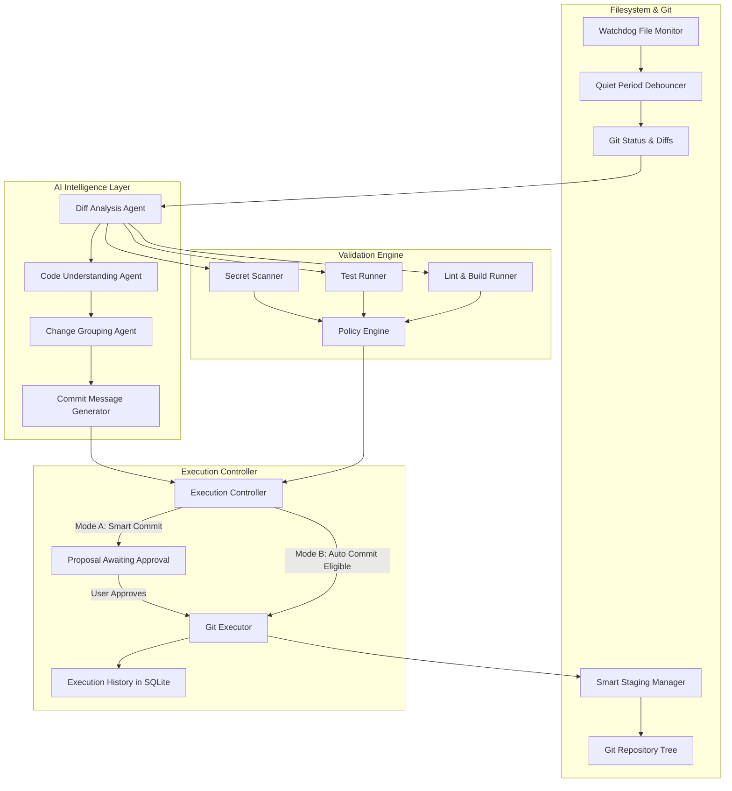
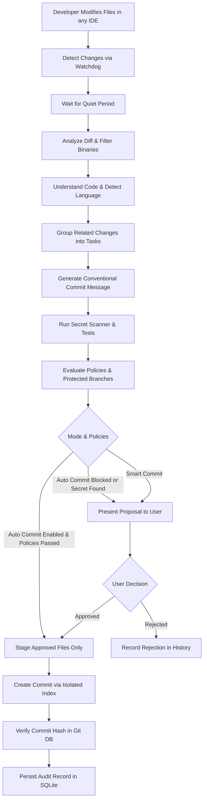

# AutoGit AI – Phase 3: User-Controlled Repositories, Random Scheduler & Autonomous Development Agent

AutoGit AI is an IDE-independent autonomous Git automation and development platform. It operates directly against local Git working trees, detecting developer modifications across any editor (Antigravity, VS Code, Cursor, JetBrains, Vim, or terminal) and executing Git operations safely according to configurable policies.

### Phase 3 Enhancements
- **User-Controlled Repository Ownership & Permission Management**:
  - AutoGit AI only operates on repositories explicitly authorized by the user.
  - Per-repository granular permissions: Monitoring, AI Analysis, Autonomous Development (default DISABLED), Smart Commit, Auto Commit (default DISABLED), Remote Push (default DISABLED).
  - Unauthorized repositories are never scanned, discovered, or touched.
- **Git Worktree Isolation**:
  - Autonomous development tasks run in dedicated isolated Git worktrees (`git worktree add -b autogit/dev-...`).
  - Active user working directories, unstaged modifications, and active indices remain completely untouched.
- **Weekly 5-Day Random Scheduler**:
  - Automatically selects exactly 5 distinct days at random each ISO week (including equal chance for weekends).
  - Persists schedule across application restarts in SQLite (never re-randomizes upon restart).
  - Automatic timezone awareness (e.g. `Asia/Kolkata` or UTC).
  - Single missed session catch-up policy to prevent aggressive bursts.
  - Pause and resume controls.
- **Autonomous Development Agent**:
  - Analyzes project context (languages, frameworks, test setups, README) without sending full codebases to LLMs.
  - Pulls from user task backlogs or suggests safe, high-value improvements (unit tests, docstrings, input validation).
  - Plans and executes approximately 2–3 targeted, safe modifications per session.
  - Strict security controls: strictly prohibited from modifying `.env`, credentials, private keys, or `.git/`.
  - Syntax verification (Python AST, JSON) with automatic rollback on failure.
  - Pre-commit quality review by Development Review Agent.
  - Integrates directly with Phase 2 Git Automation Engine for Conventional Commits and safe execution.

---

## Architecture Diagram



---

## Git Automation Workflow



---

## Project Structure

```text
AutoGit-AI/
├── main.py                          # Dual entrypoint: FastAPI app and CLI runner
├── requirements.txt                 # Runtime dependencies
├── .env.example                     # Environment template
├── .gitignore                       # Git ignore configuration
├── pytest.ini                       # Test suite settings
├── README.md                        # Project documentation
│
├── config/
│   ├── settings.py                  # Pydantic BaseSettings loader
│   └── constants.py                 # System constants, ignored directories, providers
│
├── core/
│   ├── git_manager.py               # Read-only Git inspection (status, diffs, commits)
│   ├── repository_manager.py        # Local repository registration and validation
│   ├── authentication.py            # GitHub PAT validation via /user endpoint
│   ├── credential_manager.py        # AI provider key and Git author settings
│   ├── staging_manager.py           # Selective staging preserving unrelated changes
│   ├── git_executor.py              # Safe commit creation and hash verification
│   └── execution_controller.py      # Central workflow controller & repository lock
│
├── agents/
│   ├── diff_analysis_agent.py       # Diff parsing, chunking, and statistics
│   ├── code_understanding_agent.py  # Intent, language, and risk assessment
│   ├── change_grouping_agent.py     # Logical task separation and grouping
│   ├── commit_message_agent.py      # Conventional Commit generator
│   └── validation_agent.py          # Pre-commit test and policy orchestration
│
├── ai/
│   ├── llm_client.py                # Asynchronous clients for Gemini, OpenAI, Anthropic
│   ├── provider_factory.py          # AI client factory
│   ├── prompt_templates.py          # Deterministic JSON prompt templates
│   └── response_parser.py           # Safe JSON extraction and Pydantic validation
│
├── validation/
│   ├── secret_scanner.py            # Pattern-based credential scanner
│   ├── test_runner.py               # Test framework detector and runner
│   ├── lint_runner.py               # Linter executor (Ruff, Flake8)
│   ├── build_runner.py              # Safe build/syntax checker
│   └── policy_engine.py             # Branch governance and safety thresholds
│
├── database/
│   ├── db.py                        # SQLite schema and connection pool
│   ├── models.py                    # Entity dataclasses
│   └── execution_repository.py      # Execution history, groups, and settings access
│
├── api/
│   ├── routes.py                    # Phase 1 REST routes
│   ├── execution_routes.py          # Phase 2 Automation & Execution REST routes
│   └── schemas.py                   # Pydantic API schemas
│
├── utils/
│   ├── logger.py                    # Structured logging with secret redaction
│   ├── validators.py                # Path, email, and secret masking helpers
│   └── security.py                  # Safe subprocess runner and path traversal guards
│
└── tests/
    ├── test_git_manager.py          # Git read-only integration tests
    ├── test_repository_manager.py   # Repository registration tests
    ├── test_authentication.py       # GitHub PAT validation tests
    ├── test_file_monitor.py         # Watchdog file monitoring tests
    ├── test_diff_analysis_agent.py  # Diff analysis agent tests
    ├── test_ai_agents.py            # Grouping, commit message, and understanding tests
    ├── test_validation.py           # Secret scanner, test runner, policy engine tests
    ├── test_staging_and_executor.py # Selective staging & pre-existing index tests
    ├── test_execution_controller.py # Smart & Auto Commit workflow tests
    └── test_api_execution_endpoints.py # Phase 2 REST API tests
```

---

## Installation & Setup

### 1. Prerequisites
- **Python 3.11+**
- **Git CLI** in system `PATH`

### 2. Virtual Environment Setup
```bash
# Clone or navigate to AutoGit-AI directory
cd AutoGit-AI

# Create virtual environment
python -m venv .venv

# Activate on Windows
.venv\Scripts\activate

# Activate on Linux/macOS
source .venv/bin/activate

# Install dependencies
pip install -r requirements.txt
```

### 3. Environment Configuration
Copy `.env.example` to `.env`:
```bash
copy .env.example .env     # Windows
cp .env.example .env       # Linux / macOS
```

Configure your credentials in `.env` (optional in offline/fallback mode):
```ini
GITHUB_TOKEN=ghp_your_token_here
GEMINI_API_KEY=your_gemini_key
OPENAI_API_KEY=
ANTHROPIC_API_KEY=
DEFAULT_AI_PROVIDER=gemini
APP_ENV=development
```

---

## CLI Reference & Usage

AutoGit AI provides an intuitive CLI for managing repository automations:

### 1. Repository Management
```bash
# Register a repository
python main.py add-repo "C:/Projects/my-app" --name "My App"

# List repositories
python main.py list-repos

# Inspect Git status
python main.py status 1

# Inspect Git diff
python main.py diff 1
```

### 2. Smart Commit Workflow (Default)
```bash
# 1. Analyze changes and generate proposal
python main.py propose --repo 1

# 2. View proposal details, files, and pre-commit validation results
# (Output includes proposed message, risk level, and task explanation)

# 3. Approve proposal
python main.py approve --execution 1

# 4. Execute commit
python main.py execute --execution 1

# 5. View execution history
python main.py history --repo 1
```

### 3. Auto Commit Workflow
Auto Commit must be explicitly enabled per repository:
```bash
# Check current automation mode
python main.py automation-mode --repo 1

# Enable Auto Commit mode (requires --confirm flag)
python main.py set-mode --repo 1 --mode auto --confirm

# Switch back to Smart Commit mode
python main.py set-mode --repo 1 --mode smart
```

---

## REST API Reference

Start the FastAPI backend:
```bash
python main.py run --host 127.0.0.1 --port 8000
```
Swagger Documentation: **http://127.0.0.1:8000/docs**

### Endpoints Overview

| Method | Endpoint | Description |
|---|---|---|
| `GET` | `/automation/settings/{repo_id}` | Retrieve automation settings |
| `POST` | `/automation/settings/{repo_id}` | Update automation settings |
| `GET` | `/automation/mode/{repo_id}` | Get current mode and auto commit status |
| `POST` | `/automation/mode/{repo_id}` | Switch mode (`smart` or `auto`) |
| `POST` | `/automation/analyze/{repo_id}` | Run analysis and build proposal |
| `GET` | `/automation/analysis/{exec_id}` | Get proposal details by execution ID |
| `GET` | `/automation/proposals/{repo_id}` | Get active pending proposal |
| `POST` | `/automation/proposals/{exec_id}/approve` | Approve proposal |
| `POST` | `/automation/proposals/{exec_id}/reject` | Reject proposal |
| `POST` | `/automation/proposals/{exec_id}/edit-message` | Edit proposed commit message |
| `POST` | `/automation/execute/{exec_id}` | Execute approved commit |
| `GET` | `/automation/executions/{repo_id}` | List execution history |
| `POST` | `/automation/validate/{repo_id}` | Run standalone pre-commit validations |
| `GET` | `/repositories/{id}/permissions` | Retrieve repository permissions |
| `PUT` | `/repositories/{id}/permissions` | Update repository permissions |
| `POST` | `/repositories/{id}/permissions/enable-development` | Grant autonomous development permission |
| `POST` | `/repositories/{id}/permissions/disable-development` | Revoke autonomous development permission |
| `POST` | `/repositories/{id}/permissions/revoke` | Revoke all permissions for repository |
| `GET` | `/scheduler/weekly` | Get current 5-day random weekly schedule |
| `POST` | `/scheduler/generate` | Generate or force-regenerate weekly schedule |
| `POST` | `/scheduler/pause` | Pause development scheduler |
| `POST` | `/scheduler/resume` | Resume development scheduler |
| `GET` | `/scheduler/status` | Get scheduler status, timezone, and today's schedule |
| `GET` | `/development/{repo_id}/context` | Get analyzed project context |
| `POST` | `/development/{repo_id}/analyze` | Trigger project structure analysis |
| `GET` | `/development/{repo_id}/tasks` | List pending development tasks |
| `POST` | `/development/{repo_id}/tasks` | Add task to development backlog |
| `POST` | `/development/{repo_id}/run` | Run autonomous development session |

---

## Phase 3 CLI Commands

| Command | Usage | Description |
|---|---|---|
| `permissions` | `python main.py permissions --repo <id>` | View permission settings |
| `enable-development` | `python main.py enable-development --repo <id>` | Enable autonomous development |
| `disable-development` | `python main.py disable-development --repo <id>` | Disable autonomous development |
| `schedule` | `python main.py schedule` | View 5-day random weekly schedule |
| `generate-schedule` | `python main.py generate-schedule [--force]` | Generate/regenerate schedule |
| `pause-scheduler` | `python main.py pause-scheduler` | Pause scheduler |
| `resume-scheduler` | `python main.py resume-scheduler` | Resume scheduler |
| `project-analyze` | `python main.py project-analyze --repo <id>` | Analyze language and framework |
| `add-task` | `python main.py add-task --repo <id> --title <t>` | Add development backlog task |
| `list-tasks` | `python main.py list-tasks --repo <id>` | List pending tasks |
| `development-run` | `python main.py development-run --repo <id>` | Run autonomous development session |
| `development-history` | `python main.py development-history --repo <id>` | View past development sessions |

---

## Automated Test Suite

Run the full automated test suite containing **121 tests** across all three phases:

```bash
pytest -v
```

```text
================= 121 passed, 2 warnings in 91.66s (0:01:31) ==================
```

### Comprehensive Test Breakdown (121 Passed)
- **Phase 1 Regression Suite (30 tests)**:
  - Repository CRUD, path validation, database persistence across restarts
  - Read-only Git status, unstaged and staged diffs, branch inspection
  - GitHub token validation with mocked responses (200 & 401)
  - Watchdog live external file modifications & debouncing
- **Phase 2 Intelligence & Execution Suite (28 tests)**:
  - Diff analysis, binary filtering, diff chunking
  - Code understanding, language detection, risk assessment
  - Change grouping by domain, Conventional Commit message formatting
  - Secret scanner detecting credentials and strictly masking values
  - Policy engine evaluating branch protection, file limits, secret blocks
  - Selective staging preserving pre-existing staged files and working tree
  - Git execution engine commit creation and hash verification
  - Execution controller approval/rejection, auto commit, stale invalidation
- **Phase 3 Permissions, Scheduler & Development Suite (63 tests)**:
  - `test_permissions.py` (13 tests): default safe permissions, verification, authorization enforcement, selective updates, total revocation
  - `test_weekly_scheduler.py` (12 tests): exactly 5 random days, uniqueness, chronological ordering, ISO week alignment, schedule persistence across restarts, force regeneration, pause/resume, weekend eligibility
  - `test_development_agent.py` (18 tests): project language/framework detection, task management & priority ordering, AI suggestions when backlog is empty, safe file modification & syntax checks, path traversal guards, forbidden file blocks (`.env`), authorization verification, end-to-end autonomous session execution
  - `test_worktree_manager.py` (4 tests): branch generation, worktree creation/cleanup, isolated context manager, non-git directory guard
  - `test_api_scheduler_endpoints.py` (16 tests): permissions REST API, scheduler status and generation endpoints, task management endpoints, 403 authorization guard on development run
